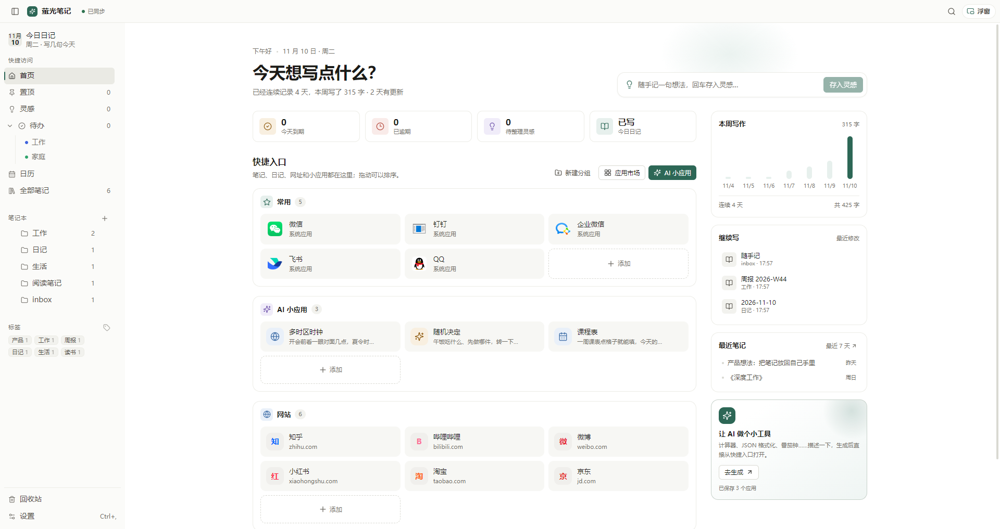
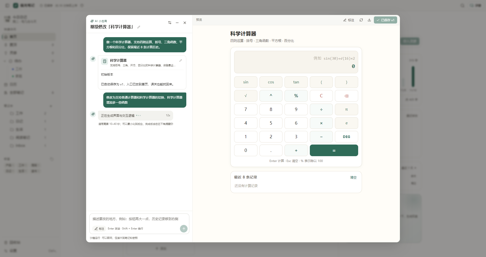
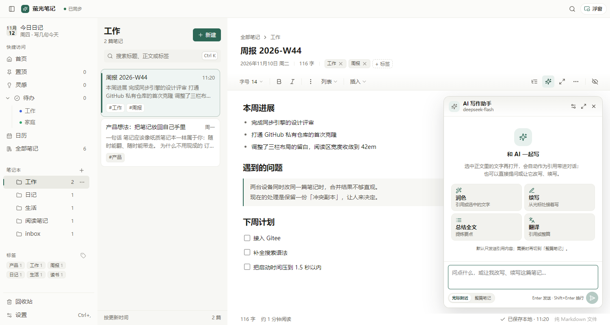

<p align="center">
  
</p>

<p align="center">
  <a href="./README.md">简体中文</a> · <strong>English</strong>
</p>

# Glimnote

> A glimmer of light for every small inspiration.

A local-first notebook: your notes live as plain Markdown on your own computer and sync across devices through a private GitHub / Gitee / GitCode repository. **No self-hosted server, no subscription, and fully usable offline.**

One codebase ships both a web app (installable as a PWA) and a Windows desktop client (Electron). The Chinese name is 萤光笔记; the English name is **Glimnote** (glimmer + note).



## Highlights

### AI mini-apps: build your own tools in plain words

Describe what you need in a chat, and the AI generates a working mini-app right away: a calculator, Pomodoro timer, habit tracker, expense log, countdown, and more. Each app is saved as an ordinary HTML file in your repository and syncs along with your notes.

- Chat on the left, live preview on the right. If something is off, just say "make the buttons bigger".
- To change only part of the page, click **Annotate** in the preview's top-right corner, mark the area with a brush, circle, box, or arrow, add a short note, and send both together. The AI prioritizes the annotated region and leaves the rest as untouched as possible.
- Every app runs in a sandbox with no access to your notes, tokens, or local files. On desktop you can open multiple independent windows side by side, or launch apps directly from the floating panel.
- Import existing single-file HTML, multi-file, or zip apps. 36 ready-to-use templates are included (Pomodoro timer, expense tracker, flashcards, loan calculator, scientific calculator, JSON formatter, regex tester, and more).
- Generation, edits, and version history (up to 10 versions) all happen locally. You supply your own model key; nothing passes through a relay service.



### Quick Access: a launchpad that opens what you need

The lower half of the home screen holds grouped shortcuts that put everyday targets on one screen: a note or journal entry, a whole notebook, frequently used websites, installed desktop apps, and mini-apps you built or installed from the marketplace. All five types can be added.

- Drag to reorder, or move items between groups. Groups can be created, renamed, and recolored; the third tab of the desktop floating panel shows the same shortcuts.
- On desktop, search the Start menu and installed applications and add them with their real icons. These entries record local paths, stay on the current computer, and do not sync through the repository.
- A new repository starts with three groups — **Frequently Used / AI Mini-apps / Websites** — plus three preinstalled mini-apps: a multi-timezone clock, a random picker, and a class schedule.
- Deleting a shortcut does not delete the app itself; you can add it back from the marketplace. Deletions also offer an undo prompt, so a mistaken click is easy to recover.

### Paper-like editor: no markers, just writing

The editor is built on CodeMirror 6. Markdown markers are hidden by default, so what you see looks close to the final page. Font, size, line spacing, and paper tint are all adjustable.

- Resize images, insert tables and code blocks, create wiki links, and use slash commands and templates right in the editor; headings and lists continue automatically.
- An outline panel, global search, and a command palette stay within reach, so even long documents are easy to navigate.
- Export Markdown, self-contained HTML, or PDF, and package an entire notebook as a ZIP file.



### AI writing chat: select, rewrite, keep asking

The AI writing button in the editor's bottom-right corner opens a chat panel. Selected text is quoted automatically, and you can keep asking follow-up questions. Replies can be copied, inserted at the cursor, used to replace the quoted text, or retried.

- Three context options: quoted text only, near the cursor, or the whole note. Quoted text is the default, so the full note is never uploaded silently.
- An empty conversation offers four quick actions: polish, continue writing, summarize the note, and translate. Right-clicking **AI polish selected text** opens the chat and starts polishing immediately.
- Conversations are remembered per note, so you can switch away and pick up where you left off. System prompts are editable, and you provide your own model key.

### Serverless: your Git repository is the backend

No cloud host to buy, no database to deploy, and no account to register with this project. Sync goes directly through your own private Git repository, so your data always stays in your hands.

- Notes, to-dos, ideas, and AI mini-apps are all ordinary files in the repository. Open them in a file manager, back them up, or edit them with another editor at any time.
- On desktop, tokens are encrypted with the system keychain; on the web they live only in the current session. If the repository is public, the app asks you to make it private first.
- When the network drops, the app switches to offline mode and resumes uploading when connectivity returns. If both devices edit the same note, a **conflict copy** is kept — changes are never silently overwritten.
- Commits are merged automatically, images are compressed automatically, and storage usage and history compaction are built in, so the Git repository does not grow out of control.
- Locked notes and notebooks sync through the repository too: after syncing on another device, the same privacy password unlocks them without re-locking. The repository stores only a salt and hash, and note bodies remain plaintext.

### MCP integration: let AI clients read and write your notes

The desktop app includes an MCP server. Turn it on in **Settings → Integrations**, and MCP-capable clients such as Claude Desktop and WorkBuddy can read and write your notes, to-dos, and ideas, and read or append to today's journal.

- 56 tools covering notes, notebooks, to-dos, ideas, journal entries, AI mini-apps, home shortcuts, and writing statistics.
- AI clients can follow the built-in specification to generate complete HTML, create, modify, or delete AI mini-apps, and read or write app data.
- HTTP and stdio transports are both supported. HTTP listens only on the loopback address, and the settings page can copy a ready-to-use client configuration.
- Changes land directly in local Markdown files and are committed by the next Git sync — no extra cloud service is required.
- The UI password lock only guards the interface, not MCP. Use a separate OS account or another machine when you need stronger isolation.

## Core features

- **Local-first Markdown**: one note per file; folders are notebooks. Export Markdown, self-contained HTML, or PDF, and archive an entire notebook as ZIP.
- **WYSIWYG editor**: CodeMirror 6 lays out content cleanly without showing Markdown markers; supports image resizing, tables, code blocks, wiki links, slash commands, and templates.
- **Organize and search**: nested notebooks, tags, pinning, smart views, calendar and timeline, global search, and a command palette with `tag:`, `in:`, and `before:` query syntax.
- **Quick Access**: grouped shortcuts for notes, websites, local apps, and mini-apps on the home screen, with drag-and-drop ordering; the desktop floating panel shows the same set.
- **To-dos**: a standalone task library with four states, categories, priorities, and due reminders. Ask AI to summarize completed items for today / the last 7 days / the last 30 days and write the summary into your journal.
- **Quick ideas**: no notebook or title needed — press Enter to save. Merge ideas into a note or split them into tasks while keeping the original text for traceability.
- **Multi-device sync**: private GitHub / Gitee / GitCode repositories, automatic and manual sync, an offline queue, backoff retries, conflict copies, and local version history.
- **Desktop experience**: tray residency, `Alt+Space` quick capture, a `Ctrl+Alt+D` to-do panel, independent mini-app windows with a shared bottom dock, and auto-update via GitCode Releases.
- **AI writing chat**: conversational writing from the editor's bottom-right corner. Selected text becomes a quote, with multi-turn follow-ups, copy / insert / replace, and per-note conversation memory. Choose quoted text only / near the cursor / the whole note; quoted text is the default.
- **UI password lock**: a local password required on launch, refresh, and reopen. The password itself never leaves your machine; the repository stores only a salt and hash, and lock records sync through the private repository. A one-time recovery code resets it if forgotten.
- **Web PWA**: installs to the desktop and runs in its own window; works offline after the first load and updates when back online.

## Getting started

Requires Node.js 20 or later.

```bash
npm install
npm run dev            # web dev server at http://localhost:5174
npm run build          # type-check + production build (dist/)
npm run preview        # preview the production build
```

Desktop:

```bash
npm run electron:dev   # start Vite and Electron together (dev hot reload)
npm run electron:start # run the built app in a desktop window
npm run electron:build # build the Windows installer into release/
```

MCP service (the desktop app can start the HTTP server with one click in Settings; the commands below are for development or stdio-only clients):

```bash
npm run mcp            # stdio
npm run mcp:http       # HTTP: http://127.0.0.1:8765/mcp
```

Checks and tests:

```bash
npm run typecheck      # TypeScript type check
npm run test:mcp       # MCP smoke tests (HTTP / ideas & journal / mini-apps)
npm run test:ui        # settings UI walkthrough (Playwright; run npx playwright install chromium first)
npm run release:verify # check that app.asar ships electron-updater and matches latest.yml (also runs during electron:build)
```

On first launch, the desktop app creates a `glimnote` folder under Documents. Every note is a plain file you can back up or open in any editor at any time.

## Tech stack

React + TypeScript + Vite, CodeMirror 6 for editing, Zustand for state, and isomorphic-git for sync; Electron on desktop, with hand-written CSS instead of a UI framework.

## License

[MIT](LICENSE) © 2026 Glimnote contributors

## Project layout

```
src/            UI, editor, state, and local repository logic
  components/   three-column layout, command palette, settings, editor, preview
  lib/          storage adapters, note repository, Git sync, search, import/export
  styles/       design tokens and styles (hand-written CSS)
  store/        Zustand app state and autosave scheduling
electron/       main process and preload (windows, tray, floating panel, updates, filesystem)
mcp/            MCP service (stdio / HTTP)
docs/           screenshots used in the README
scripts/        release helper scripts
```
