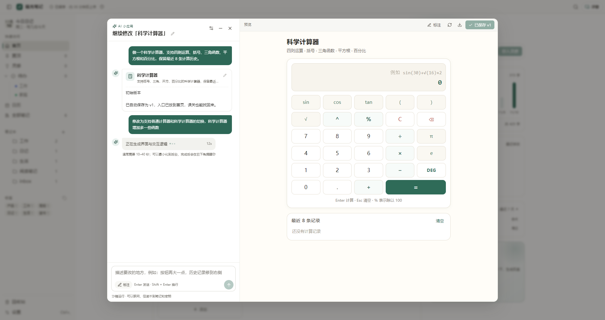
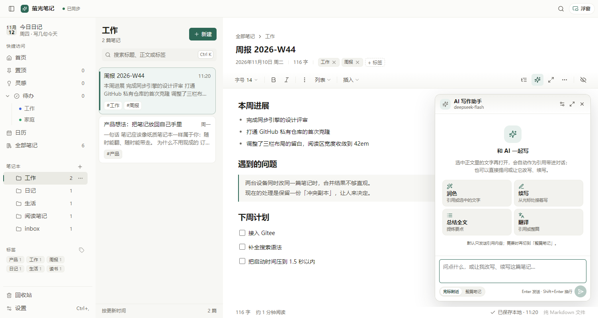

<p align="center">
  
</p>

<p align="center">
  <strong>简体中文</strong> · <a href="./README.en.md">English</a>
</p>

<p align="center">
  <a href="https://gitcode.com/jewey/glimnote/releases">下载最新版</a> ·
  <a href="https://gitcode.com/jewey/glimnote">GitCode 源码仓库</a> ·
  <a href="https://gitee.com/jewey/glimnote">Gitee</a> ·
  <a href="https://github.com/jeweya/glimnote">GitHub</a>
</p>

# 萤光笔记 Glimnote

> 萤火微光，记录细碎微小的灵感。

本地优先的云笔记：笔记以纯 Markdown 保存在自己的电脑上，通过 GitHub / Gitee / GitCode 私有仓库在多台设备间同步。**没有自建服务器，没有订阅，断网也能照常写。**

一套代码同时产出网页版（可安装为 PWA）与 Windows 桌面客户端（Electron）。中文名「萤光笔记」，英文名 **Glimnote**（glimmer + note：微光与记录）。


## 核心亮点

### AI 小应用：用自己的话，造自己的工具

在应用里用聊天描述需求，AI 直接生成一个能运行的小应用：计算器、番茄钟、习惯打卡、记账、倒数日……生成即保存为仓库里的普通 HTML 文件，随笔记一起同步。

- 左侧对话、右侧实时预览，不满意就继续说「把按钮改大一点」。
- 只想改局部时，点预览右上角的「标注」，用画笔、圆圈、方框或箭头在页面上标出位置，再补一句说明一起发送；AI 会优先改被标注的区域，其余部分尽量保持原样。
- 每个应用都在沙箱里运行，读不到笔记、令牌和本地文件；桌面端可以开多个独立窗口并排使用，也能从桌面浮窗直接打开。
- 支持导入现成的单文件 HTML、多文件或 zip 应用，内置 36 个开箱即用的模板（番茄钟、记账本、记忆卡片、贷款计算器、科学计算器、JSON 格式化、正则测试等）。
- 生成、修改、历史版本（最多 10 份）都在本地完成，模型 Key 由你自己填写，不经过任何中转服务。



### 快捷入口：打开就到的启动台

首页下半屏是可分组的快捷入口，把常用目标摆在一屏里：某篇笔记或日记、整个笔记本、常用网站、本机安装的软件，以及自己生成或从应用市场装的小应用，五类都能加。

- 拖动即可排序，也能跨分组移动；分组可以新建、改名、换色，桌面端浮窗的第三个页签会同步显示同一套入口。
- 桌面端能搜索开始菜单和应用程序，带真实图标直接加入首页；这类入口记录的是本机路径，只存当前电脑，不随仓库同步。
- 新仓库自带「常用 / AI 小应用 / 网站」三个分组，并预装多时区时钟、随机决定、课程表三个小应用，装好就能用。
- 误删入口不会删掉应用本身，可从应用市场加回来；删除时也有撤销提示，不用担心点错。

### 纸感编辑器：不露标记，专注写字

编辑区默认是 TipTap 富文本，Markdown 标记不显示，看到的就是接近成稿的样子；需要改源码时一键切到 CodeMirror 6 源码模式。字体、字号、行距与纸张底色都可以按喜好调整。

- 图片缩放、表格、代码块、双链、斜杠命令与模板都在编辑器里直接完成，标题和列表会自动接续。
- 目录大纲、全局搜索与命令面板常驻手边，长文也能快速定位。
- 可导出 Markdown、自包含 HTML 与 PDF，整个笔记本能打包成 ZIP。



### AI 写作对话：选中就能改，追问不用换工具

编辑器右下角的 AI 写作按钮展开就是聊天窗：选中的文字会自动作为引用带进对话，可以连续追问，回复能直接复制、插入光标、替换引用或重试。

- 三种上下文可选：仅引用、光标附近、整篇笔记；默认只发引用，不会悄悄把全文上传。
- 空白对话提供润色、续写、总结全文、翻译四个快捷动作；右键「AI 润色选中文字」会直接打开聊天窗并开始润色。
- 对话按笔记分别记住，切到别的笔记再回来还能接着聊；系统提示词可改，模型 Key 由自己填写。

### 免服务器：你的 Git 仓库就是后端

不需要买云主机、部署数据库或注册本项目的账号。同步直接走你自己的私有 Git 仓库，数据始终在自己手里。

- 笔记、待办、灵感、AI 小应用都是仓库里的普通文件，随时可以用资源管理器打开、备份，或用别的编辑器修改。
- 桌面端 Token 用系统密钥加密保存，网页端只放在当前会话；发现仓库是公开的会先提醒改为私有。
- 断网自动转入离线，恢复后继续上传；两端改到同一篇笔记时保留「冲突副本」，绝不静默覆盖。
- 提交自动合并、图片自动压缩、容量明细与历史压缩，尽量不让 Git 仓库被撑大。
- 加锁的笔记与笔记本记录也随仓库同步：换一台设备同步后，同一个隐私密码就能直接解锁，不用重新加锁；仓库里只有盐和哈希，正文仍然是明文。

### MCP 集成：让 AI 客户端直接读写笔记

桌面端内置 MCP 服务。在「设置 → MCP集成」打开开关，Claude Desktop、WorkBuddy 等支持 MCP 的客户端就能直接读写你的笔记、待办与灵感，并读取或追加当天日记。

- 共 56 个工具，覆盖笔记、笔记本、待办、灵感、日记、AI 小应用、首页入口与写作统计。
- AI 客户端可以按内置规范生成完整 HTML，直接创建、修改或删除 AI 小应用，并读写应用数据。
- 支持 HTTP 与 stdio 两种连接方式；HTTP 只监听本机回环地址，设置页可以复制现成的客户端配置，也可以点「让 AI 帮你接入」把提示词发给 WorkBuddy 等能操作本机的 AI 客户端，由它自动完成配置（装完记得重启客户端）。
- 改动直接落到本地 Markdown 文件，下一次 Git 同步照常提交，不需要额外的云端服务。
- 界面密码锁只挡界面、不挡 MCP；需要更强隔离时，请使用独立系统账户或另一台机器。

## 核心功能

- **本地优先的 Markdown**：一篇笔记一个文件，文件夹就是笔记本；可导出 Markdown、自包含 HTML、PDF，整库可打包 ZIP。
- **所见即所得编辑器**：默认 TipTap 富文本，不露 Markdown 标记也能正常排版，源码模式基于 CodeMirror 6；支持图片缩放、表格、代码块、双链、斜杠命令与模板。
- **组织与检索**：多级笔记本、标签、置顶、智能视图、日历与时间轴、全局搜索和命令面板，支持 `tag:`、`in:`、`before:` 等搜索语法。
- **快捷入口**：首页按分组摆放笔记、网站、本机软件与小应用入口，支持拖拽排序；桌面浮窗同步显示，常用目标一步直达。
- **待办清单**：独立任务库，四种状态、分类、优先级与到点提醒；可按今天 / 近 7 天 / 近 30 天让 AI 总结已完成事项并写进日记。
- **灵感速记**：不用选笔记本、起标题，回车即存；可合并成笔记或拆成待办，原文保留可追溯。
- **多端同步**：GitHub / Gitee / GitCode 私有仓库，自动与手动同步、离线队列、退避重试、冲突副本和本地历史版本。
- **桌面体验**：托盘常驻、`Alt+Space` 快速捕获、`Ctrl+Alt+D` 待办浮窗、独立小应用窗口与底部合并条，以及基于 GitCode Releases 的自动更新。
- **AI 写作对话**：编辑器右下角可对话式写作，选中文字即引用，支持多轮追问、复制 / 插入 / 替换、按笔记记住会话；支持仅引用 / 光标附近 / 整篇三种上下文，默认只发引用。
- **界面密码锁**：给界面加一道本地密码，启动、刷新、重新打开都要解锁；密码本身不上传，仓库里只有盐和哈希，加锁记录随私有仓库同步，忘记可用一次性恢复码重设。
- **网页版 PWA**：安装到桌面后独立窗口运行，首次打开后可离线写作，重新联网即更新。

## 快速开始

普通用户不需要安装 Node.js：到 [GitCode Releases](https://gitcode.com/jewey/glimnote/releases) 下载最新的 Windows 安装包 `Glimnote-Setup-x.y.z.exe`，双击安装即可。

下面的命令面向开发者，需要 Node.js 20 或更高版本。

```bash
npm install
npm run dev            # 网页版开发 http://localhost:5174
npm run build          # 类型检查 + 生产构建（dist/）
npm run preview        # 预览构建产物
```

桌面端：

```bash
npm run electron:dev   # 同时启动 Vite 与 Electron（开发热更新）
npm run electron:start # 构建后以桌面窗口运行
npm run package:win    # 打包 Windows 安装包，输出到 release/
npm run release:win    # 完整发版：打包 + latest.yml + 校验 + 归档到 release/v<版本>/
```

MCP 服务（桌面端可在设置里一键启动 HTTP 服务；以下命令供开发或只认 stdio 的客户端使用）：

```bash
npm run mcp            # stdio
npm run mcp:http       # HTTP: http://127.0.0.1:8765/mcp
```

检查与测试：

```bash
npm run typecheck      # TypeScript 类型检查
npm run test:mcp       # MCP 冒烟测试（HTTP / 灵感日记 / AI 小应用）
npm run test:ui        # 设置页界面走查（Playwright，需先执行 npx playwright install chromium）
npm run release:verify # 校验 app.asar 是否带自动更新组件、与 latest.yml 是否一致（package:win 会自动执行）
```

### 发版：改版本号与写更新说明

1. 改版本号：只改 `package.json` 的 `version`（推荐 `npm version 0.1.22 --no-git-tag-version`，会同时更新 `package-lock.json`）。这是唯一来源，安装包文件名、程序版本和 `latest.yml` 里的版本号都从这里取，`build/installer.nsi` 不用动。
2. 写更新说明：在 `CHANGELOG.md` 顶部新增 `## 0.1.22` 小节，按 `### 新增` / `### 优化` / `### 修复` / `### 打包` 分条写。`npm run release:folder` 会把这一节的正文自动提取成 `release/v0.1.22/更新说明.md`，不用另写一份。
3. 打包并发布：运行 `npm run release:win`（打包 → 生成 `latest.yml` → 校验 → 归档到 `release/v0.1.22/`），再把该目录里的安装包、`latest.yml`、`更新说明.md` 上传到 GitCode Release（tag 用 `v0.1.22`）并正式发布。

更细的打包与更新源说明见 [docs/mydoc/06-桌面端打包与发布.md](docs/mydoc/06-桌面端打包与发布.md)。

桌面端首次启动会在「文档」下创建 `glimnote` 文件夹，所有笔记都是普通文件，可以随时备份或用其它编辑器打开。

## 仓库地址

- GitHub：<https://github.com/jeweya/glimnote>
- Gitee：<https://gitee.com/jewey/glimnote>
- GitCode：<https://gitcode.com/jewey/glimnote>（Windows 安装包与自动更新清单发布在这里，客户端检查更新也走这个仓库）

下载安装包请到 GitCode 的 [Releases](https://gitcode.com/jewey/glimnote/releases) 页面。

## 技术栈

React + TypeScript + Vite，TipTap 富文本编辑器（源码模式 CodeMirror 6），Zustand 状态管理，isomorphic-git 同步；桌面端为 Electron，界面样式为手写 CSS，不依赖 UI 框架。

## 许可证

[MIT](LICENSE) © 2026 Glimnote contributors

## 目录

```
src/            界面、编辑器、状态与本地仓库逻辑
  components/   三栏界面、命令面板、设置、编辑器与预览
  lib/          存储适配、笔记仓库、Git 同步、搜索、导入导出
  styles/       设计令牌与样式（手写 CSS）
  store/        Zustand 应用状态与自动保存调度
electron/       主进程与 preload（窗口、托盘、浮窗、更新、文件系统）
mcp/            MCP 服务（stdio / HTTP）
docs/           README 用到的截图
scripts/        发版辅助脚本
```
